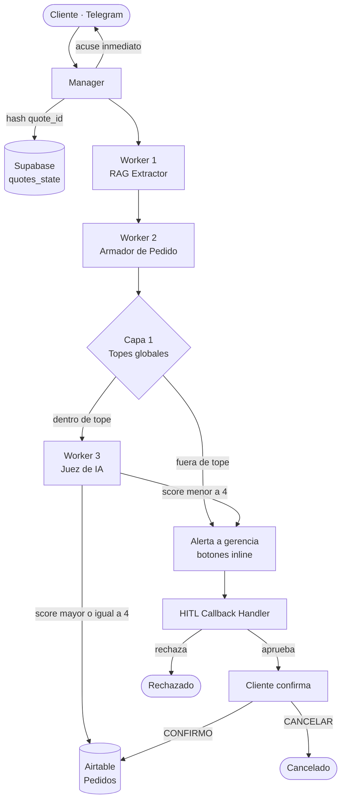

# Agente de Ventas B2B con Gobernanza HITL y Auditoría de Márgenes

Proyecto Final Integrador · **AI Automation Avanzado** (Coderhouse) · Cohorte 2026
Autor: **Carlos Osorio**

Sistema multi-agente en **n8n** que recibe pedidos B2B por Telegram, los estructura contra las políticas comerciales (RAG), los audita con un **Juez de IA** (AI-as-a-Judge), deriva las excepciones a **aprobación humana (HITL)** con botones en Telegram y exige la **confirmación explícita del cliente** antes de registrar el pedido en Airtable.

> La documentación ejecutiva completa (arquitectura, auditoría y ROI) está en el PDF de entrega `Osorio_Carlos_ProyectoFinal_AI_Experto.pdf`. Este repositorio contiene los workflows exportados.

---

## Qué problema resuelve

La validación manual de descuentos y plazos de pago genera demoras de hasta 48 h y riesgo de aprobar operaciones fuera de margen. Este sistema responde al cliente de inmediato, procesa en segundo plano y solo involucra a gerencia cuando hay una excepción real.

## Principios de diseño

| Principio | Cómo se implementa |
|---|---|
| Asincronía | El cliente recibe un acuse inmediato; el análisis corre en segundo plano |
| Idempotencia | `quote_id` = hash del `chat_id` + mensaje normalizado; un duplicado no se reprocesa |
| Supervisión obligatoria | Nada se registra en el CRM sin pasar por los topes de política y el Juez de IA |
| Consentimiento doble | Gerencia aprueba los números; el cliente confirma con `CONFIRMO` |
| Fallar seguro | Todo fallo técnico (moderación, JSON inválido, sin precios) deriva a una persona |

## Arquitectura (patrón Manager-Worker)



## Workflows incluidos

| Archivo | Rol |
|---|---|
| `Manager - Agente Ventas B2B.json` | Orquestador principal y máquina de estados |
| `worker_1_rag_extractor.json.json` | Extrae catálogo y políticas desde la base documental (Supabase) |
| `Worker 2 - Armador de Pedido.json` | Estructura el pedido respetando cantidad solicitada y topes; reintento ante JSON inválido |
| `Worker 3 - AI-as-a-Judge.json` | Audita margen, cálculos, crédito y fuentes; score 0–5 |
| `HITL Callback Handler.json` | Procesa los botones Aprobar / Rechazar de gerencia |

## Máquina de estados (`quotes_state`)

| Estado | Significado |
|---|---|
| `PROCESSING` | Pedido recibido, en análisis |
| `PENDING_HUMAN` | Bloqueado por gobernanza; espera a gerencia |
| `AWAITING_CLIENT_CONFIRM` | Gerencia aprobó con ajustes; espera `CONFIRMO` o `CANCELAR` |
| `COMPLETED` | Pedido firme, registrado en Airtable |
| `REJECTED_BY_HUMAN` | Gerencia rechazó la excepción |
| `REJECTED_BY_CLIENT` | El cliente descartó las condiciones ajustadas |

```
nuevo -> PROCESSING -> COMPLETED                                   (aprobación automática)
PROCESSING -> PENDING_HUMAN -> AWAITING_CLIENT_CONFIRM -> COMPLETED (gerencia aprueba + CONFIRMO)
AWAITING_CLIENT_CONFIRM -> REJECTED_BY_CLIENT                       (CANCELAR)
PENDING_HUMAN -> REJECTED_BY_HUMAN                                  (gerencia rechaza)
```

## Gobernanza en dos capas

| Capa | Control | Umbral | Si se incumple |
|---|---|---|---|
| 1. Topes globales | Reglas determinísticas en el Manager | Descuento máx. 10 %, plazo máx. 30 días | Escala a gerencia |
| 2. Juez de IA | Auditoría independiente (Worker 3) | Score mínimo 4 sobre 5 | Escala a gerencia |

Guardas técnicas: falla del Armador (`FALLO TÉCNICO`), RAG sin precios base, reintento con espera de 10 s, lectura robusta del Juez en tres intentos con fallback a score 0.

## Stack (100 % freemium)

n8n (orquestación) · Supabase (estado y base documental) · Airtable (registro de pedidos firmes) · Telegram Bot API (canal de cliente y de gerencia) · OpenRouter (modelos gratuitos).

---

## Puesta en marcha

### 1. Requisitos

- Instancia de n8n (Community o Cloud de prueba)
- Proyecto de Supabase, base de Airtable, dos bots de Telegram (clientes y gerencia) y una cuenta de OpenRouter

### 2. Tablas

**Supabase · `quotes_state`**

| Columna | Tipo |
|---|---|
| `quote_id` | text (clave única) |
| `chat_id` | int8 |
| `status` | text |
| `created_at` | timestamp |
| `productos` | text (JSON serializado) |
| `total_final` | numeric |
| `plazo_pago` | text |
| `mensaje_cliente` | text |

**Supabase · `documents`**: `id`, `content` (text), `metadata` (jsonb), `embedding` (vector). Cargá allí el catálogo y las políticas (ver más abajo).

**Airtable · `Pedidos`**: `Cliente` (número), `SKU_Productos` (texto), `Total` (número), `Plazo_Pago` (texto), `Status` (texto), `Dictamen_Juez` (texto largo), `Fecha_Creacion` (fecha).

### 3. Datos de ejemplo para `documents`

```
CATÁLOGO DE PRODUCTOS:
- SKU-001: Caja de Tornillos Industriales, Precio Base: $10.00 USD, Stock disponible: 500 unidades.
- SKU-002: Martillo Profesional, Precio Base: $15.00 USD, Stock disponible: 200 unidades.

POLÍTICA DE DESCUENTOS:
- Compras menores a 50 unidades: Sin descuento (0%).
- Compras entre 50 y 100 unidades: Descuento del 5%.

POLÍTICA DE CRÉDITO Y PLAZOS DE PAGO:
- Plazo estándar: Contado (pago inmediato).
- Plazo máximo autorizado para clientes regulares: 30 días.
```

### 4. Credenciales en n8n

Crear en **Credentials** (nunca se guardan en los JSON):

| Credencial | Uso |
|---|---|
| Telegram API (bot de clientes) | Trigger del Manager y mensajes al cliente |
| Telegram API (bot de gerencia) | Trigger y edición de mensajes del HITL Callback Handler |
| Supabase API | Lectura y escritura de `quotes_state` y `documents` |
| Airtable Personal Access Token | Alta de pedidos firmes |
| OpenRouter API | Modelos de lenguaje de los tres workers |

### 5. Importación

1. Importá primero los **workers** (Worker 1, Worker 2, Worker 3) y el **HITL Callback Handler**.
2. Importá el **Manager** al final.
3. En el Manager, abrí los nodos **Ejecutar Worker 1: RAG**, **Ejecutar Worker 2: Armador** y **Ejecutar Worker 3: Juez** y volvé a seleccionar el workflow correspondiente (los IDs cambian al importar).
4. Reasigná las credenciales en cada nodo que las use.
5. Activá los workflows que tienen trigger de Telegram (Manager y HITL Callback Handler).

### 6. Configuración del token del bot de gerencia

Por seguridad, el JSON del Manager no incluye el token. El nodo **Enviar Alerta a Gerentes** tiene en su URL el marcador `bot<TELEGRAM_MANAGER_BOT_TOKEN>`: reemplazalo por el token de tu bot de gerencia en tu instancia (o migrá el nodo a un nodo nativo de Telegram con credencial).

También hay que ajustar, en el nodo de código que arma la alerta, la constante `chatIdGerentes` con el ID de tu grupo de gerencia.

---

## Cómo probarlo

| Mensaje del cliente | Resultado esperado |
|---|---|
| `quiero 10 unidades del sku 001 con 5% de descuento y 30 días de plazo` | Acuse inmediato, ajuste al tramo de catálogo (0 %), aprobación automática, total USD 100 |
| `quiero 20 unidades del sku 001 con 50% de descuento y 90 días de plazo` | Alerta a gerencia con botones **Aprobar Excepción / Rechazar Pedido** |
| Gerencia aprueba → cliente responde `CONFIRMO` | Estado `COMPLETED` y registro en Airtable |
| Gerencia aprueba → cliente responde `CANCELAR` | Estado `REJECTED_BY_CLIENT`, sin registro en Airtable |
| El mismo pedido enviado dos veces | Respuesta según el estado existente, sin reprocesar |

## Limitaciones conocidas

- Los modelos gratuitos de OpenRouter tienen latencia variable y moderación intermitente (mitigado con reintento y guardas).
- El Worker 1 lee todos los documentos (`getAll`) sin búsqueda por similitud; es válido para un catálogo pequeño.
- La extracción de cantidad, descuento y plazo usa expresiones regulares sobre el mensaje del cliente.
- El estado `APPROVED_BY_HUMAN` quedó reservado y no se usa en el flujo actual.

## Hoja de ruta

- Migrar a un proveedor de modelos estable para producción
- Búsqueda vectorial real con embeddings en el Worker 1
- Trazabilidad de auditoría: historial de scores y decisiones por `quote_id`
- Soporte multi-SKU con validación de stock
- Métricas operativas: latencia, tasa de derivación a HITL y tasa de confirmación

## Seguridad

Este repositorio no contiene claves, tokens ni contraseñas. Las conexiones se gestionan con credenciales de n8n. Si reutilizás estos workflows, cargá tus propias credenciales y no subas exportaciones de tu instancia sin revisarlas antes.
